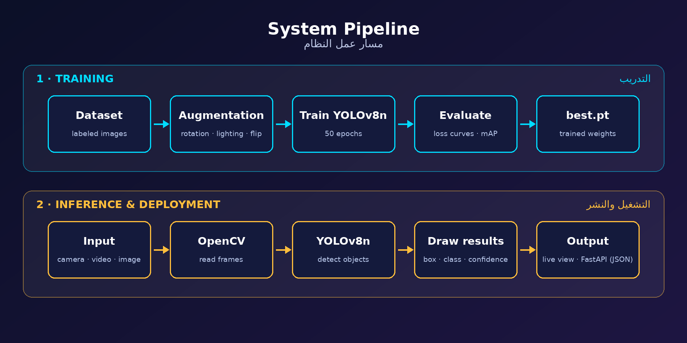

# Real-Time Object Detection & Classification
### نظام ذكي للكشف عن الأجسام وتصنيفها في الوقت الفعلي

A computer-vision system that detects and classifies multiple objects (people, cars, bicycles, traffic lights, ...) in live camera streams, video files, and images using **YOLOv8n**, with a lightweight **FastAPI** service for deployment.



## Features
- Real-time detection from webcam, video, or image (OpenCV + YOLOv8n)
- Bounding boxes with class name and confidence score drawn on each frame
- Training script with built-in data augmentation (rotation, lighting, flip)
- REST API: upload an image or video, get JSON results or an annotated image

## Tech Stack
Python · PyTorch · Ultralytics (YOLOv8) · OpenCV · NumPy · Pandas · FastAPI · Git

## Project Structure
```
.
├── train.py           # train YOLOv8n on a custom dataset
├── detect.py          # real-time detection (camera / video / image)
├── api.py             # FastAPI service
├── data.yaml          # dataset configuration
├── requirements.txt
└── README.md
```

## Installation
```bash
pip install -r requirements.txt
```

## Usage

**1. Train**
```bash
python train.py --data data.yaml --epochs 50
```
Outputs (loss curves, confusion matrix, `best.pt`) are saved in `runs/train/`.

**2. Real-time detection**
```bash
python detect.py --source 0                                   # webcam
python detect.py --source video.mp4 --save out.mp4            # video file
python detect.py --weights runs/train/weights/best.pt --source photo.jpg
```
Press `q` to quit.

**3. Run the API**
```bash
uvicorn api:app --reload
```
Open http://127.0.0.1:8000/docs for the interactive documentation.

| Endpoint | Description |
|---|---|
| `GET /health` | Service status |
| `POST /predict` | Image in, detections out (JSON) |
| `POST /predict/image` | Image in, annotated image out |
| `POST /predict/video` | Video in, per-frame detections out (JSON) |

Example response from `POST /predict`:
```json
{
  "filename": "street.jpg",
  "width": 1280,
  "height": 720,
  "count": 2,
  "detections": [
    {"class_id": 0, "class_name": "person", "confidence": 0.91,
     "bbox": {"x1": 412.3, "y1": 188.0, "x2": 530.7, "y2": 640.2}}
  ]
}
```

## Results
> Fill this table with the real numbers printed at the end of `train.py`
> and measured on your own machine. Do not publish numbers you did not measure.

| Metric | Value |
|---|---|
| mAP@0.5 | _TODO_ |
| mAP@0.5:0.95 | _TODO_ |
| Inference speed (FPS) on my hardware | _TODO_ |
| Training epochs | 50 |
